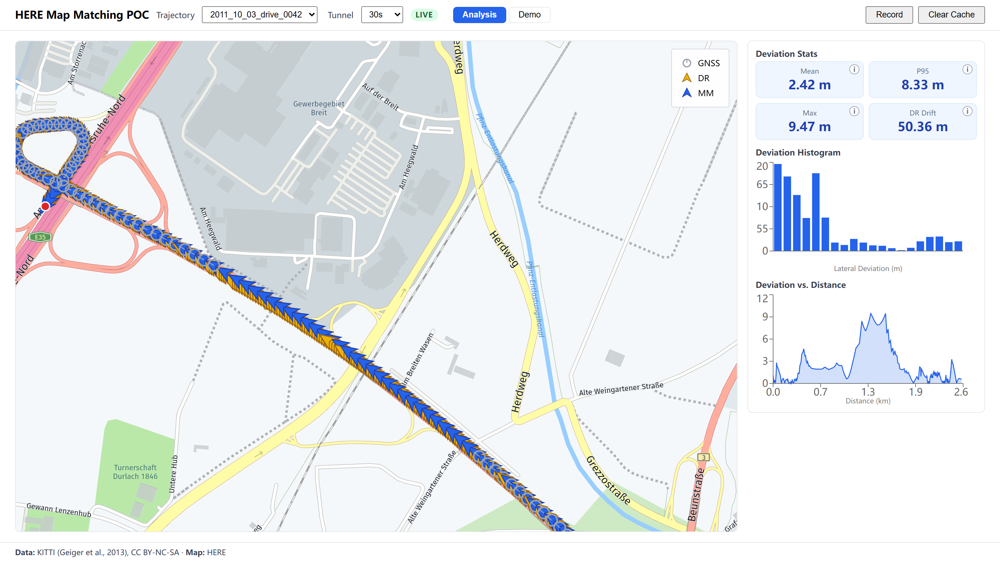
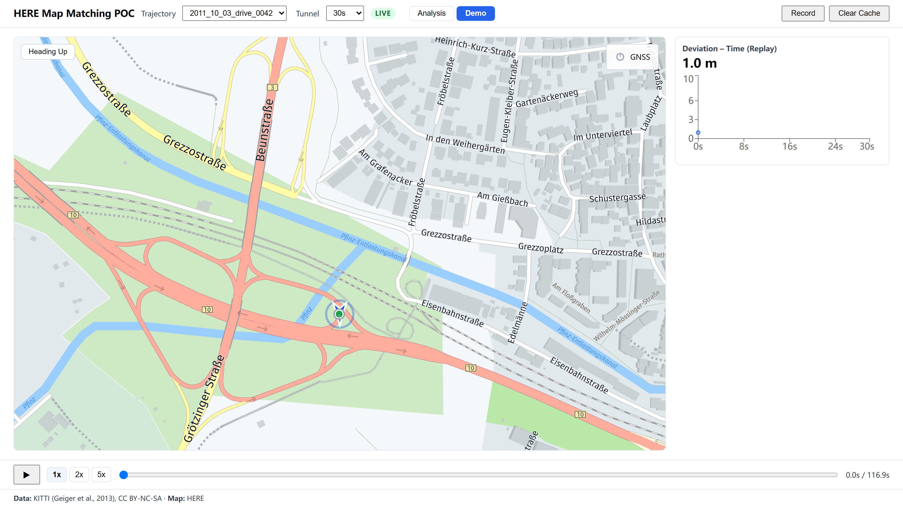
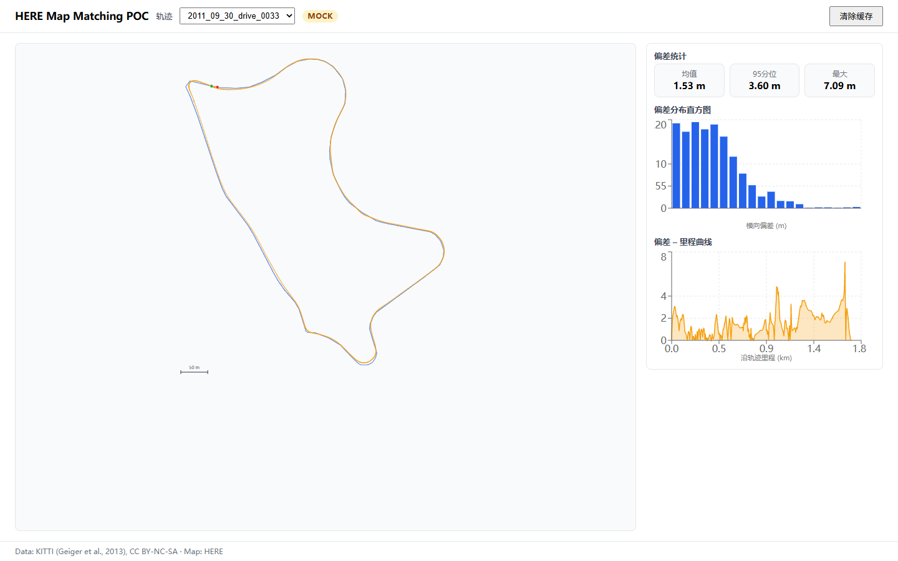

# HERE Trace-Matching POC

**Live demo:** https://richard666chong-netizen.github.io/HERE-MM/

**A buyer's-view evaluation harness for HERE cloud trace matching under GNSS degradation — real KITTI drives, OEM acceptance metrics, and an honest measurement of where the correction stops working.**





## Why this exists

When an OEM evaluates a location platform, the decisive questions are not feature-list questions. They are: *how well does the platform keep a vehicle on the road network when GNSS degrades — and at what point does it stop managing?* This project answers those questions against the real HERE APIs, with the same metrics an OEM acceptance process would use.

Three things it is designed to demonstrate:

1. **Buyer's methodology** — deviation is measured the way a vehicle-engineering acceptance team measures it: per-point lateral deviation to the matched route, mean / **p95** / max (p95 is the classic OEM acceptance bound), not eyeballed screenshots.
2. **Domain depth** — map matching, dead reckoning, GNSS outage behavior, and the coupling between them are the author's production domain (in-vehicle navigation, lane-level positioning).
3. **The boundary** — the most valuable finding is *where* cloud trace matching stops correcting, and why that argues for tightly-coupled, map-aided positioning in production.

The scenario city is Karlsruhe, Germany — European road network, EU data-protection regime. That is precisely the environment a vehicle exported from China to Europe has to navigate in; this harness is the evaluation such a program would run.

## Quick start

```bash
npm install
npm run dev        # fully functional offline — bundled fixtures, MOCK badge
```

Optional live mode (HERE Platform **Base Plan** freemium key works):

```bash
echo "VITE_HERE_KEY=<your-key>" > .env   # gitignored; dev-only
npm run dev                              # LIVE badge; responses cached to localStorage
```

| Script | Purpose |
|---|---|
| `npm run dev` | Dev server; fixture mode without a key, live mode with one |
| `npm test` | 177 tests / 20 files (Vitest) — unit + contract tests pinning the HERE response schema |
| `npm run build` | Production bundle — ships a **Trusted-Domains-restricted** HERE key (see below) |
| `npm run shot` | Recapture the README screenshots headlessly (system Edge/Chrome via playwright-core) |
| `npm run record:dr -- <driveId> [--tunnel 30]` | Re-record a fixture from the live API with the DR-augmented trace |

The deployed build ships a real HERE key **on purpose**: it is locked by HERE **Trusted Domains** — server-side Referer validation restricted to this site's GitHub Pages domain (absent or wrong-domain Referers get 401; verified 2026-10-20). Honest boundary: Referer validation stops browser-context reuse — someone embedding the key on their own site — but a non-browser client that spoofs the `Referer` header will pass. That is the standard protection level for public browser keys (the same class as Google Maps browser-key restrictions). The blast radius is capped by design: this key carries Base-Plan free-tier access only — no billing, no platform write scope (those require OAuth credentials, which are not in the bundle) — and it can be revoked from the platform console at any time. `scripts/deploy-pages.mjs` refuses to publish a non-empty `VITE_HERE_KEY` unless `ALLOW_PUBLIC_KEY=1` is set explicitly, so an unrestricted key can never reach `gh-pages` silently. Visitors on networks that block HERE assets still get the full offline chain: cached responses → bundled fixtures → SVG fallback.

## What you see

**Analysis mode** — full-map static comparison: raw GNSS scatter (orange, drawn only where the receiver actually reported a fix), local dead-reckoning path (purple, rendered when degradation is present), and the HERE-matched route (blue). Side panel: deviation histogram, deviation-vs-distance curve, and summary stats.

**Demo mode** — playback at 1×/2×/5× with north-up / heading-up views, the vehicle moving along the matched route while raw GNSS points sprinkle in and the deviation curve rolls.

**Tunnel control** — a GNSS-denial duration knob (Off / 30 / 60 / 120 s). This is the honesty centerpiece: trajectory, heading, speed and accelerations are **all real KITTI data**; the *only* simulated quantity is how long GNSS is denied — which is the physical definition of a tunnel.

## Key findings

Measured on `2011_10_03_drive_0042` (highway, 79.6 km/h average) with the denial window starting at 30% of the drive:

| Denial | DR drift (max) | HERE match result | Truth → matched route |
|---|---|---|---|
| 30 s | ~12–13 m | **1 section / 2594 m** (true length 2590 m) | mean **1.19 m** / max **6.10 m** ✅ |
| 60 s | 66.9 m (58.6 m lateral) | 2 sections / 2431 m — **followed the drift onto a side road** | max **49.85 m** ⚠️ |
| 60 s, frozen-input control | — | 1 section / 2536 m | robust to "stuck" input ✅ |

1. **Cloud trace matching corrects within roughly a lane-width budget.** At ~11 m of lateral drift it snaps the vehicle cleanly back to the main carriageway; at ~58 m it faithfully matches the drifted trace onto the wrong road. This is not a HERE defect — it is the inherent ceiling of a *serial* DR→MM pipeline, where the matcher has no way to know the dead-reckoned positions have drifted. Production systems close this gap with **tight coupling (map-aided dead reckoning / lane-level positioning)**, which is exactly the next-tier product conversation.
2. **HERE's matcher is robust to frozen input.** Sending the un-enhanced, position-frozen stream during denial still yields one clean 2536 m section — it treats the stall as waiting. Route fragmentation comes from noise and jumps, not from missing data.
3. **Plan-tier discovery (worth knowing before you demo anything):** HERE Route Matching API v8 (`/v8/match/routelinks`) is **Enterprise-plan-only since 2025-03-15** — a Base Plan key gets HTTP 429 with `X-RateLimit-Limit: 0`. Routing API v8 `POST /v8/import` (trace → matched route as flexible polyline, 2–50 000 points) is the Base-plan equivalent; per-point correction is then computed client-side by this app (perpendicular projection onto the decoded polyline).
4. **Real-degradation drives included as contrasts:** `0096` (longest real outage in KITTI: 34.3 s under tree canopy — 12.4 m lateral drift) and `0106` (22.7 s full-drive urban canyon — only **0.9 m** lateral drift: the error is almost entirely along-track, so the DR line stays on the lane and matching has nothing to fix). `0093` is kept as a stress case with reduced truth quality (its own position accuracy reaches ±21 m during outage — the deviation figures for that drive carry that uncertainty).

## Data and honesty

- **Source:** KITTI raw dataset, `oxts` channel — OXTS RT3000 GNSS+IMU, 10 Hz, WGS-84, Karlsruhe (CC BY-NC-SA 3.0; non-commercial evaluation use, attribution given). No coordinate conversion (HERE is native WGS-84).
- **Why the tunnel is simulated:** an exhaustive scan of all 156 KITTI raw drives (camera-frame verified) found **no tunnels** — the longest real outages are urban canyon, tree canopy and a pedestrian zone. Rather than pretend, the denial duration is an explicit, UI-visible scenario parameter.
- **The DR is deliberately simple:** heading + speed integration with 1 Hz GNSS correction (gain 0.3), gated by satellite count and fix availability. It runs on OXTS-processed outputs, i.e. simplified dead reckoning *on top of* a professional INS — the harness measures matching behavior, not DR quality. An ESKF/strapdown upgrade path is documented but intentionally out of scope.
- **OXTS output is not independent ground truth** (it is INS-bridged during outages, not RTK). The DR-drift metric compares two algorithms on the same sensor suite, and the docs say so.

## Architecture

```
KITTI oxts trace (10 Hz, WGS-84)
  ↓ buildGnssFeed          — real outages (posmode == 0) + optional simulated tunnel window
  ↓ deadReckon             — local DR: free integration during denial, 1 Hz GNSS correction otherwise
  ↓ liveTrace              — DR-augmented trace (what gets sent to HERE)
  ↓ HERE Routing v8 /import — matched route, flexible polyline (decoded in-app)
  ↓ derive                 — per-point projection → deviationM, heading, speed
  → map layers / replay / stats
```

- **Stack:** Vite 7 · React 19 · TypeScript · Recharts. HERE Maps API for JavaScript 3.1 loaded via script tag with a self-built loader (no HERE npm SDK) — including a **basemap tile probe**, because enterprise networks can silently drop tiles while the SDK script loads fine.
- **Offline-first, four layers deep:** live API → localStorage cache (keyed per drive *and* tunnel variant) → bundled fixture (recorded from the live API) → SVG no-basemap fallback. The demo cannot die of network conditions.
- **Testing:** 177 Vitest tests, including contract tests that fail if the HERE response schema drifts, and regression locks pinning the measured drift values (e.g. 0042 @60 s → 66.86 m).

## From POC to production (solution-architect notes)

What I would discuss with a customer after this demo:

- **Cloud API vs in-vehicle SDK** — this harness exercises the cloud path (fine for fleet/analysis use cases); a production vehicle needs offline capability, latency and per-call cost bounds, and privacy guarantees → HERE's in-vehicle navigation SDK / on-device matching tier.
- **Coupling** — the 60 s boundary is the technical argument for map-aided positioning and lane-level maps as the upsell, not a caveat to hide.
- **Data residency & compliance** — for export programs, EU processing/GDPR and per-country geodata regulation are first-order questions, and the map vendor's compliance posture is part of the solution.
- **Plan tiers** — Base vs Enterprise capability differences (see finding 3) materially shape PoC design: prototype on `/import`, budget for the Enterprise tier if per-link confidence and `/v8/match` semantics are required.

## Repository layout

```
src/                 app code (lib/ = data pipeline, components/ = UI, __tests__/)
public/sample/here/  demo trajectories (KITTI-derived, lightweight)
public/fixtures/     recorded HERE /import responses (offline mode)
scripts/             fixture recording scripts
docs/img/            screenshots
docs/superpowers/    design specs & step plans (Chinese, detailed)
```

## Credits & license

- Data: **KITTI** (Geiger et al., 2013), CC BY-NC-SA — used here for non-commercial demonstration only.
- Map tiles: **© HERE**.
- Application code: **CHANG Zhen**; no open-source license attached (interview/portfolio artifact). The KITTI-derived sample traces inherit CC BY-NC-SA.
